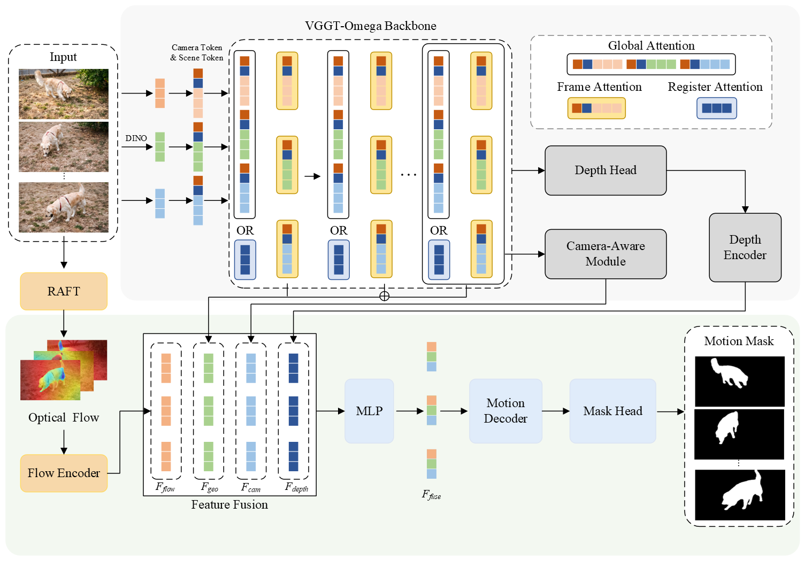

<div align="center">

# OmegaMotion: Mining Multi-Level Geometric Priors from 3D Foundation Models for Video Motion Segmentation

<p>
  <a href="mailto:jhshen.cs13@gmail.com">Jia-Hui Shen</a><sup>1</sup> &emsp;
  <a href="mailto:chengsun@gapp.nthu.edu.tw">Cheng Sun</a><sup>2</sup> &emsp;
  <a href="mailto:vitec6@gmail.com">Min-Hung Chen</a><sup>2</sup> &emsp;
  <a href="mailto:aoncpc@gmail.com">Fu-En Yang</a><sup>2</sup> &emsp;
  <a href="mailto:yulunliu@cs.nycu.edu.tw">Yu-Lun Liu</a><sup>1</sup> &emsp;
  <a href="mailto:lin@cs.nycu.edu.tw">Yen-Yu Lin</a><sup>1</sup>
</p>

<p>
  <sup>1</sup>Department of Computer Science, National Yang Ming Chiao Tung University, Hsinchu, Taiwan<br>
  <sup>2</sup>NVIDIA, Taipei, Taiwan
</p>

[](https://huggingface.co/jokervicky/OmegaMotion)
[](LICENSE)

*The manuscript is currently under review. A public paper and arXiv link are not
available at this time.*

</div>

## 📖 About OmegaMotion

OmegaMotion is a video motion-segmentation framework built on top of
[VGGT-Ω](https://github.com/facebookresearch/vggt-omega). It combines multi-level
latent geometric features, camera-aware tokens, depth cues, and RAFT optical flow,
then predicts a dense foreground-motion mask with a dedicated motion decoder.
Optional [SAM 2](https://github.com/facebookresearch/sam2) refinement can be used
to improve the spatial consistency of the predicted masks.

This repository provides training, inference, and DAVIS-style evaluation code.

## 🏗️ Architecture

OmegaMotion extracts multi-level geometric features from a frozen VGGT-Ω
backbone and combines them with camera-aware context, confidence-aware depth
features, and bidirectional RAFT motion cues. The aligned feature streams are
fused and processed by a motion decoder and mask head to produce per-frame
motion masks.

<div align="center">
  
</div>

## 🔥 News / Updates

- **[2026.08]** Training and evaluation code released.
- **[2026.08]** The pretrained OmegaMotion checkpoint is available on Hugging Face.

---

## ⚙️ 1. Environment Setup

The codebase uses Python 3.12 and PyTorch 2.5.1 or newer. A CUDA-capable GPU is
recommended for both training and inference.

```bash
git clone https://github.com/Jokervicky07/MyMotion.git
cd MyMotion

conda create -n omegamotion python=3.12 -y
conda activate omegamotion
pip install -r requirements.txt
```

Install VGGT-Ω under the repository root if it was not included in your clone:

```bash
git clone https://github.com/facebookresearch/vggt-omega.git vggt_omega
pip install -e ./vggt_omega
```

SAM 2 is optional and is only required when `--use_sam_refine true` is enabled.
Download its checkpoints with:

```bash
cd sam2-main/checkpoints
bash download_ckpts.sh
cd ../..
```

## 📦 2. Model Checkpoint

Please download the required weights and place them inside the `checkpoints/`
directory.

| Model | Description | Expected Path | Download Link |
| :--- | :--- | :--- | :--- |
| **VGGT-Ω Backbone** | Backbone initialization for training | `checkpoints/vggt_omega_1b_512.pt` | [🤗 Hugging Face (VGGT-Ω)](https://huggingface.co/facebook/VGGT-Omega/blob/main/vggt_omega_1b_512.pt) |
| **OmegaMotion** | Trained motion-segmentation model; full checkpoint for inference | `checkpoints/vggt_omega_v2.pth` | [🤗 Hugging Face (OmegaMotion)](https://huggingface.co/jokervicky/OmegaMotion/blob/main/vggt_omega_v2.pth) |

Download OmegaMotion using the Hugging Face CLI:

```bash
hf download jokervicky/OmegaMotion vggt_omega_v2.pth \
  --local-dir checkpoints
```

Or download the file directly:

```bash
wget -P checkpoints \
  https://huggingface.co/jokervicky/OmegaMotion/resolve/main/vggt_omega_v2.pth
```

The resulting checkpoint layout is:

```text
checkpoints/
├── vggt_omega_v2.pth          # Full OmegaMotion inference checkpoint
└── vggt_omega_1b_512.pt       # VGGT-Ω initialization; required for training only
```

The released `vggt_omega_v2.pth` is a **full checkpoint**, including both the
VGGT-Ω backbone and the OmegaMotion-specific modules. The separate
`vggt_omega_1b_512.pt` can be obtained from the
[official VGGT-Ω model page](https://huggingface.co/facebook/VGGT-Omega) and is
only needed to initialize a new training run.

RAFT is initialized from `--raft_model_path` when a local checkpoint is given.
Otherwise, the implementation falls back to the default torchvision RAFT-Large
weights. When SAM 2 refinement is enabled, also provide a compatible SAM 2
configuration and checkpoint.

## 🚀 3. Inference

### 3.1 Prepare the input

For a single sequence, place the frames in one directory:

```text
input/sequence_name/
├── 00000.jpg
├── 00001.jpg
└── ...
```

Frames are sorted by filename, so zero-padded names are recommended.

### 3.2 Single-sequence inference

```bash
python infer_vggt_omega.py \
  --model_path checkpoints/vggt_omega_v2.pth \
  --input_dir input/sequence_name \
  --output_root outputs/sequence_name \
  --sequence_length 32 \
  --device cuda
```

To use a local RAFT checkpoint, add:

```bash
--raft_model_path /path/to/raft_large.pth
```

### 3.3 Multi-sequence inference

When the input root contains one directory per sequence, use `--image_root`:

```bash
python infer_vggt_omega.py \
  --model_path checkpoints/vggt_omega_v2.pth \
  --image_root /path/to/dataset/JPEGImages/480p \
  --output_root outputs/dataset \
  --sequence_length 32 \
  --device cuda
```

### 3.4 SAM 2 refinement

```bash
python infer_vggt_omega.py \
  --model_path checkpoints/vggt_omega_v2.pth \
  --input_dir input/sequence_name \
  --output_root outputs/sequence_name \
  --sequence_length 32 \
  --use_sam_refine true \
  --sam2_config_path configs/sam2.1/sam2.1_hiera_l.yaml \
  --sam2_checkpoint_path sam2-main/checkpoints/sam2.1_hiera_large.pt \
  --sam_seed_threshold 0.8
```

Inference produces the following directories:

```text
outputs/sequence_name/
├── raw/<sequence_name>/      # OmegaMotion soft-mask predictions
├── sam/<sequence_name>/      # SAM 2-refined soft masks, when enabled
├── final/<sequence_name>/    # Thresholded masks used for evaluation
└── vis/<sequence_name>/      # Visualizations and inference summaries
```

Use `--save_masks_at_original_size true` to save masks at the original frame
resolution. Run `python infer_vggt_omega.py --help` for all available options.

## 📂 4. Dataset Preparation

The current training configuration uses Dynamic Replica / Dynamic Stereo-style
data, HOI4D, DynamicVerse, and MOSE. Update `train_dataset`, `train_root`,
`test_dataset`, and `test_root` in
`configs/vggt_motion_fusion_6layers_12frame.yaml` before training.

The dataset names and root paths must remain in the same order:

```yaml
train_dataset: ["dynamic_stereo", "hoi4d", "dynamicverse", "mose"]
train_root:
  - /path/to/dynamic_stereo
  - /path/to/HOI4D_clean
  - /path/to/DynamicVerse
  - /path/to/MOSE
```

For DAVIS-style inference and evaluation, use the following layout:

```text
DAVIS/
├── JPEGImages/480p/<sequence>/*.jpg
└── Annotations/480p/<sequence>/*.png
```

## 📊 5. Evaluation

First run inference with the dataset frame root. Then evaluate the masks stored
under the generated `final/` directory:

```bash
python evaluate.py \
  --pred_root outputs/davis/final \
  --gt_root /path/to/DAVIS/Annotations/480p \
  --output_dir results/davis2016 \
  --threshold 0.5 \
  --bound_th 0.008 \
  --missing_policy zero \
  --sequence_list splits/davis2016.txt
```

The evaluator reports DAVIS region similarity (`J`), boundary accuracy (`F`),
and their mean (`J&F`). It saves dataset-, sequence-, and frame-level results as
CSV and JSON files.

## 🏃 6. Training

### 6.1 Configure paths

Edit `configs/vggt_motion_fusion_6layers_12frame.yaml` and set at least:

- `train_dataset` and `train_root`
- `test_dataset` and `test_root`
- `vggt_omega_model_path`
- `raft_model_path`
- `log_dir`

The default configuration freezes the VGGT-Ω backbone and trains the feature
fusion and motion-decoder modules at 512 × 512 resolution with 12-frame clips.

### 6.2 Start training

For the two-GPU setup in `train.sh`:

```bash
bash train.sh
```

Or launch training explicitly and adjust the visible devices and process count:

```bash
CUDA_VISIBLE_DEVICES=0,1 torchrun \
  --master-port=29501 \
  --nproc_per_node=2 \
  train_vggt_omega_v1.py \
  configs/vggt_motion_fusion_6layers_12frame.yaml
```

Checkpoints, logs, and validation visualizations are written to the configured
`log_dir`.

## 🙏 7. Acknowledgements

This project builds on the following excellent open-source projects:

- [VGGT-Ω](https://github.com/facebookresearch/vggt-omega)
- [VGGT](https://github.com/facebookresearch/vggt)
- [RAFT](https://github.com/princeton-vl/RAFT)
- [SAM 2](https://github.com/facebookresearch/sam2)

Please also follow the licenses and usage terms of the upstream models,
checkpoints, and datasets used by this project.

## 📄 8. License

OmegaMotion's original code is released under the [MIT License](LICENSE).
Third-party components, pretrained models, and datasets remain subject to their
respective licenses and terms of use.
